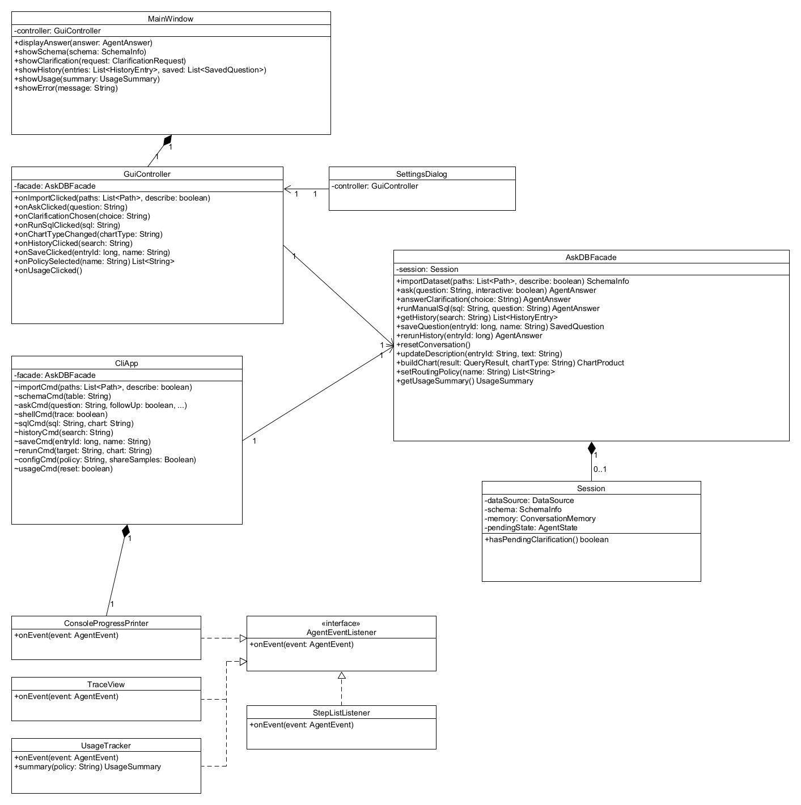
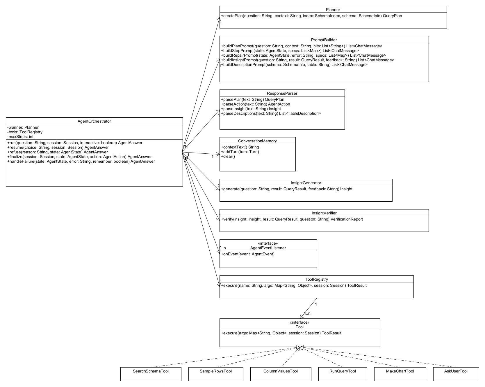
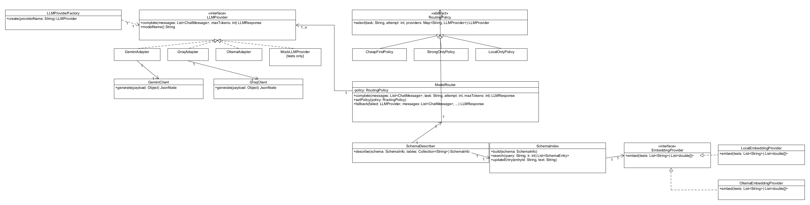
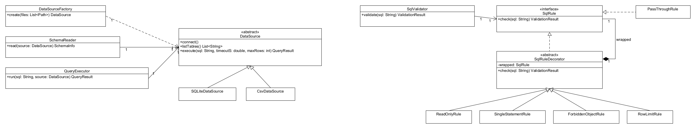
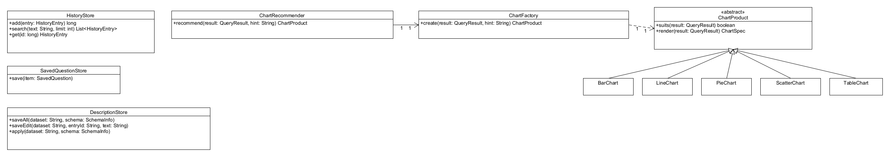

# 1. Project overview and implementation status

**Application.** AskDB is a natural-language data analyst agent written in Java 21. An analyst imports a SQLite database or CSV files and asks questions in plain English. The agent plans a read-only query, runs it through a safety guard, repairs it if it fails, and shows four things: the SQL, the result table, a chart, and a short summary whose numbers are checked against the result. The intended users are analysts, students, and small-business owners who know their data but do not write SQL every day.

**Interfaces.**

- **GUI.** A Swing desktop window, started with `askdb-gui.cmd` (or `askdb gui`), with four tabs: Ask, Schema, History, and Usage and Trace. It also has a Settings dialog.
- **CLI.** A picocli command line, `askdb`, with these commands: `import`, `schema`, `describe`, `ask`, `shell`, `sql`, `history`, `save`, `rerun`, `config`, `usage`, and `gui`.

Both interfaces call only `AskDBFacade`. The project builds with Maven (`mvnw.cmd package`), which produces one runnable jar, `target/askdb.jar`.

**AI and LLM integration.**

- The working system uses a local model, `qwen2.5-coder:7b`, served by Ollama. It is free and needs no API key.
- `GeminiAdapter` and `GroqAdapter` are implemented for the optional free cloud tiers. They activate only when a key is placed in the local `.env` file.
- Schema search uses Ollama's `nomic-embed-text` embedding model when it is pulled. Otherwise it uses `LocalEmbeddingProvider`, a small offline embedder written in Java (Section 4).

The LLM takes part in the following:

- **Planning.** It classifies each request as query, destructive, or unanswerable; detects ambiguity; and hints a chart type.
- **Multi-step tool use** inside a bounded plan, act, observe loop. The six tools are `search_schema`, `sample_rows`, `column_values`, `run_query`, `make_chart`, and `ask_user`.
- **Repair** of failed queries.
- **Clarification questions.**
- **Follow-up memory.**
- **Schema descriptions.**
- **Summaries.**

Every model output is parsed, validated, and checked by deterministic code before it has any effect.

**Status.** All twelve Stage 1 features (F01–F12) are implemented in Java and run in both interfaces. All seven Stage 1 patterns are in the code. Section 4 lists every difference from the Stage 1 design.

**How the language changed.** Stage 1 named Python. The first Stage 2 commits (October 22 and October 28) built a Python version. The Stage 2 instructions require Java, so on October 28 the Python code was removed and the same design was implemented in Java in one new commit ([f24f884](https://github.com/krishi-shah/AskDB-Data-Analyst-Agent/commit/f24f88464820d0e47582c2648a9cb1be99a4767c)). The earlier Python commits stay in the history unchanged. The Java classes keep the Stage 1 class names, responsibilities, and patterns; only the libraries changed (Section 4, change 1).

**Limitations (honest status).**

1. **Speed.** On the development laptop (GTX 1650 Ti with 4 GB, i7-10750H, 16 GB RAM), the 7B model runs partly on the CPU. In the Java test runs an answered question needed 4 to 6 model calls and about 1 to 2.5 minutes of model time; the average model call took about 20 seconds. A refused request needed one call. Importing a new dataset also writes descriptions for each table once, which took about 1.5 minutes for the four sample tables. After that, descriptions are cached.
2. **Semantic SQL mistakes.** The guard and the number verifier cannot catch a query that is valid but answers the wrong question. In a recorded run, "What is the monthly revenue in 2025?" produced one yearly total instead of twelve monthly totals. The number check passed, because the summary matched that result.
3. **Cloud tiers untested.** The Gemini and Groq adapters are written against the public REST APIs but were not run, because no keys were used during development. Without keys, Cheap First and Strong Only fall back to the local model. This is the "missing API key" alternative flow from F12.
4. **Clarification depends on the model.** With `qwen2.5-coder:7b`, "Which is the best region?" stopped and offered two meanings (highest total revenue or most orders). The Java version was tested only with the 7B model. With the earlier Python version, the smaller `qwen2.5-coder:3b` never marked a question as ambiguous; it picked a meaning and answered. In the CLI, clarification also needs an interactive console. With `--no-interactive`, or when input is piped, the agent picks the most common meaning and states it.
5. **Offline schema search is word-based.** `LocalEmbeddingProvider` matches shared words and word parts (for example "order" and "orders"), not synonyms. `nomic-embed-text` handles synonyms, but it was not pulled on the development laptop, so that path was not exercised in testing.

# 2. Feature to implementation mapping

Each feature below uses the mapping fields from the Stage 2 instructions. File paths are relative to `src/main/java/ca/yorku/askdb/`. The video column will hold the timestamped links listed in Section 7.

## F01 — Dataset Import

| Mapping field | Entry |
|---|---|
| Stage 1 feature/reference | F01 (UC01, SD01) |
| Status or change | Implemented |
| Implemented classes/files and responsibilities | `MainWindow` / `GuiController` (`presentation/gui/`) pick the files; `CliApp.importCmd` (`presentation/cli/CliApp.java`) does the same in the terminal. `AskDBFacade.importDataset` (`app/AskDBFacade.java`) coordinates. `DataSourceFactory` (`data/DataSourceFactory.java`) checks the extension and size and creates the source. `SQLiteDataSource` checks the file header and opens the file with `SQLiteConfig.setReadOnly(true)`. `CsvDataSource` reads each CSV with Apache Commons CSV and loads it into an in-memory SQLite database, then sets `PRAGMA query_only = ON`. `SchemaReader` reads columns, keys, row counts, and sample rows. `Session` (`app/Session.java`) holds the result. |
| Key methods | `onImportClicked()`, `importCmd()`, `importDataset()`, `DataSourceFactory.create()`, `connect()`, `SchemaReader.read()` |
| Design patterns | Facade, Factory, Adapter |
| Video link/timestamp | See Section 7, F01 |

**Collaboration.** The user picks files. The controller passes the paths to the facade, which asks the factory for the right `DataSource`. For CSV, the adapter creates one table per file; a column becomes `INTEGER` or `REAL` only when every non-empty value parses as a number. The schema reader builds `SchemaInfo`. The facade then runs F02 and stores a new `Session` with an empty memory. Unsupported types, files over the size limit, files that are not SQLite, empty CSVs, and CSVs without a header all produce a clear error. **Type:** deterministic.

## F02 — Schema Explorer

| Mapping field | Entry |
|---|---|
| Stage 1 feature/reference | F02 (UC01, UC02, SD01) |
| Status or change | Implemented, with two documented changes: `DescriptionStore` and the embedding providers (Section 4) |
| Implemented classes/files and responsibilities | `SchemaDescriber` (`retrieval/SchemaDescriber.java`) asks the model for table and column descriptions, one call per table. `PromptBuilder.buildDescriptionPrompt` assembles the prompt, including up to 3 sample rows if sharing is on. `ResponseParser.parseDescriptions` reads the JSON. `DescriptionStore` (`storage/DescriptionStore.java`) caches descriptions per dataset and keeps the analyst's edits. `SchemaIndex` (`retrieval/SchemaIndex.java`) embeds every table and column entry and answers `search()`. `OllamaEmbeddingProvider` or `LocalEmbeddingProvider` creates the vectors. `MainWindow.showSchema` shows an editable table with one row per table and per column. |
| Key methods | `describe()`, `buildDescriptionPrompt()`, `complete()`, `parseDescriptions()`, `SchemaIndex.build()`, `search()`, `embed()`, `updateEntry()`, `AskDBFacade.updateDescription()`, `showSchema()` |
| Design patterns | Builder, Adapter, State (routing of the `describe` task) |
| Video link/timestamp | See Section 7, F02 |

**Collaboration.** On import, cached descriptions are applied first. Only tables without a description are sent to the model, so a failed call is retried on the next import. The index builds one entry per table and per column. If no embedder works, the index switches to keyword search and the interface shows a warning. Editing a description (double-click in the Schema tab, or `askdb describe orders.status "..."`) saves it with an `edited` flag, so a later automatic description never overwrites it, and it re-embeds that entry. **Type:** hybrid.

## F03 — Natural Language Question Answering

| Mapping field | Entry |
|---|---|
| Stage 1 feature/reference | F03 (UC03, SD02) |
| Status or change | Implemented |
| Implemented classes/files and responsibilities | `AskDBFacade.ask` starts the run. `AgentOrchestrator` (`agent/AgentOrchestrator.java`) runs the bounded loop: at most 8 steps and 3 repairs. `Planner` asks for a `QueryPlan`. `PromptBuilder` and `ResponseParser` build and parse every message. `ToolRegistry` (`agent/tools/ToolRegistry.java`) checks argument names and types, then runs one of the six tools in `agent/tools/`. `RunQueryTool` validates and executes SQL. `ModelRouter` (`llm/ModelRouter.java`) picks the provider. `AgentAnswer` carries the result to the interface. In the GUI, a `SwingWorker` runs the agent so the window stays responsive. |
| Key methods | `ask()`, `run()`, `createPlan()`, `buildStepPrompt()`, `complete()`, `parseAction()`, `ToolRegistry.execute()`, `finalize()` |
| Design patterns | Facade, Builder, State, Adapter, Observer |
| Video link/timestamp | See Section 7, F03 |

**Collaboration.** The planner sends the question, the conversation context, and the schema (the whole schema when there are 8 tables or fewer, otherwise the retrieved entries). It receives a JSON plan. A destructive request is refused and an unanswerable one gets `NO_DATA`; in both cases no tool runs.

In the loop, the step prompt lists the tool specifications, the schema, the plan, and the last six observations. The model returns one action. The registry rejects unknown tools and bad arguments, and the rejection message becomes the next observation. A final answer is accepted only after a query has run. Repeating the previous tool call with the same arguments is not run again; the model is told "You already called … with these arguments" and asked to take a different step.

`finalize()` builds the chart (F08) and the verified summary (F09), stores the turn in memory (F10), and returns the answer. The facade records the answer in history (F11). **Type:** AI.

## F04 — Ambiguity Clarification

| Mapping field | Entry |
|---|---|
| Stage 1 feature/reference | F04 (UC04, SD04) |
| Status or change | Implemented |
| Implemented classes/files and responsibilities | `Planner` sets `ambiguous` with a `ClarificationRequest`. `AskUserTool` (`agent/tools/AskUserTool.java`) lets the model ask during the loop. The orchestrator saves the `AgentState` in the `Session` and returns `NEEDS_CLARIFICATION`. `MainWindow.showClarification` shows option buttons and a free-text box. `GuiController.onClarificationChosen` / `CliApp` (numbered options in the console) collect the choice. `AskDBFacade.answerClarification` calls `AgentOrchestrator.resume`. |
| Key methods | `createPlan()`, `AskUserTool.execute()`, `showClarification()`, `onClarificationChosen()`, `answerClarification()`, `resume()` |
| Design patterns | Facade, Builder |
| Video link/timestamp | See Section 7, F04 |

**Collaboration.** The paused state keeps the plan and the observations. `resume()` adds the chosen meaning (for example "Best by what? → highest total revenue") to the state, and every later step and repair prompt includes it. After two rounds, or in non-interactive mode, `ask_user` is removed from the tool list and the agent is told to pick the most common meaning. **Type:** AI.

## F05 — Query Safety Guard

| Mapping field | Entry |
|---|---|
| Stage 1 feature/reference | F05 (UC06, SD03, SD05) |
| Status or change | Implemented, with one added class: `PassThroughRule` (Section 4) |
| Implemented classes/files and responsibilities | `SqlRule` (interface) and `SqlRuleDecorator` (`safety/`) define the chain. `SingleStatementRule` rejects multiple statements, after blanking comments, string literals, and quoted names. `ReadOnlyRule` allows only `SELECT`/`WITH` and rejects write keywords, including inside a CTE. `ForbiddenObjectRule` blocks `PRAGMA`, `ATTACH`, `load_extension`, `sqlite_master`, and the file functions. `RowLimitRule` wraps the query in `SELECT * FROM (...) LIMIT n`. `SqlValidator` builds the chain. `QueryExecutor` and `DataSource.execute` cancel a statement that runs longer than 10 seconds (a scheduled `Statement.cancel()`). The read-only connection is the second safety layer. |
| Key methods | `SqlValidator.validate()`, `SqlRule.check()`, `SqlRuleDecorator.apply()`, `QueryExecutor.run()` |
| Design patterns | Decorator |
| Video link/timestamp | See Section 7, F05 |

**Collaboration.** `RunQueryTool` and `runManualSql` both call `validate()` first. A rejection names the rule and gives the reason. The agent sees it as an observation; the user sees it as a `REFUSED` answer, for example "Query blocked by read_only: Only SELECT queries are allowed; the data is read only." Even if a rule had a bug, the database connection itself rejects writes. **Type:** deterministic.

## F06 — Self-Correcting Query Repair

| Mapping field | Entry |
|---|---|
| Stage 1 feature/reference | F06 (UC07, SD03) |
| Status or change | Implemented |
| Implemented classes/files and responsibilities | `AgentOrchestrator.handleFailure` counts repairs, remembers the failing SQL, and stops at 3 repairs or on repeated failing SQL. `PromptBuilder.buildRepairPrompt` includes the failed SQL, the error, the schema, and the tool list. `ModelRouter.complete(messages, "repair", attempt, maxTokens)` lets `CheapFirstPolicy` switch to the strong tier from attempt 2. `ColumnValuesTool` shows the real stored values for fixing filters. |
| Key methods | `handleFailure()`, `buildRepairPrompt()`, `complete()`, `RoutingPolicy.select()`, `ColumnValuesTool.execute()` |
| Design patterns | State, Builder |
| Video link/timestamp | See Section 7, F06 |

**Collaboration.** A SQLite error, a guard rejection, or an unexpected empty result (once) starts a repair. If the model then concludes that there are no matching rows, the empty result is accepted and the answer is `NO_DATA` (Section 4, change 12). If the same failing SQL comes back after normalizing case, spacing, and the trailing semicolon, the run ends with `FAILED` and the last error. A scripted check repairs a query that groups by a column the table does not have. **Type:** hybrid.

## F07 — SQL Review and Manual Editing

| Mapping field | Entry |
|---|---|
| Stage 1 feature/reference | F07 (UC08, SD05) |
| Status or change | Implemented |
| Implemented classes/files and responsibilities | The SQL editor and **Run SQL** button in `MainWindow`; `GuiController.onRunSqlClicked`; `CliApp.sqlCmd`. `AskDBFacade.runManualSql` validates, executes, picks a chart through `ChartRecommender`, and records the run in history marked manual. |
| Key methods | `onRunSqlClicked()`, `sqlCmd()`, `runManualSql()`, `validate()`, `run()`, `recommend()`, `HistoryStore.add()` |
| Design patterns | Facade, Decorator |
| Video link/timestamp | See Section 7, F07 |

**Collaboration.** Every agent answer puts its SQL in the editor. The analyst can change it and run it. No model is called, so the result appears in milliseconds and is returned as an `AgentAnswer`, which the GUI shows exactly like an agent answer. **Type:** deterministic.

## F08 — Automatic Chart Generation

| Mapping field | Entry |
|---|---|
| Stage 1 feature/reference | F08 (UC03, SD02, SD05) |
| Status or change | Implemented |
| Implemented classes/files and responsibilities | `MakeChartTool` is called in `finalize()` with the plan's chart hint. `ChartRecommender` asks `ChartFactory` (`charts/ChartFactory.java`), which returns the hinted chart if it suits the result, otherwise the first that suits, in this order: `LineChart`, `BarChart`, `ScatterChart`, `PieChart`, `TableChart`. Each product's `render()` builds a `ChartSpec`. `ChartRenderer` draws the spec with JFreeChart, in a `ChartPanel` in the GUI or as a PNG for the CLI. |
| Key methods | `MakeChartTool.execute()`, `recommend()`, `ChartFactory.create()`, `suits()`, `render()`, `AskDBFacade.buildChart()`, `onChartTypeChanged()` |
| Design patterns | Factory |
| Video link/timestamp | See Section 7, F08 |

**Collaboration.** Suitability rules:

- A date or month column with numbers gives a line chart.
- Up to 30 labelled rows give a bar chart.
- Two numeric columns give a scatter chart.
- 2 to 8 non-negative shares can be a pie chart.
- Anything else gives a table.

Choosing a type in the GUI list calls `buildChart`. If that type does not fit, the status bar says so and the fitting chart is shown. `askdb ask ... --chart` saves a PNG in `out/`; `--chart pie` (or another type) asks for one type. **Type:** hybrid (the hint comes from the model; the choice is deterministic).

## F09 — Grounded Insight Summary

| Mapping field | Entry |
|---|---|
| Stage 1 feature/reference | F09 (UC03, SD02) |
| Status or change | Implemented |
| Implemented classes/files and responsibilities | `InsightGenerator` builds the insight prompt (at most 50 rows) and calls the router. For an empty result it returns a fixed message without a model call. `InsightVerifier` extracts every number, ignoring commas, `$`, and `%`, and matches it within a rounding tolerance against result cells, the row count, column totals, mean, min, max, range, shares, differences, ratios, and percentage changes. Numbers from the question, small ordinals, and years are allowed. `VerificationReport` lists the checked and unverified numbers. |
| Key methods | `generate()`, `buildInsightPrompt()`, `parseInsight()`, `verify()`, `VerificationReport.feedback()` |
| Design patterns | Builder, State |
| Video link/timestamp | See Section 7, F09 |

**Collaboration.** If any number is unverified, `finalize()` regenerates the summary once with the list of bad numbers as feedback. Anything still unverified is shown as a yellow "Unverified: …" badge instead of the green "Numbers verified" badge. In a recorded Java run, "What is the total revenue by customer region?" gave the four correct region totals, but the summary claimed an overall total of **$959,316.14**. The four rows add up to **$859,336.00**. The verifier flagged the number, the regenerated summary repeated it, and the GUI showed "Unverified: $959,316.14". **Type:** hybrid.

## F10 — Follow-Up Conversation Memory

| Mapping field | Entry |
|---|---|
| Stage 1 feature/reference | F10 (UC05, SD04) |
| Status or change | Implemented, with one addition: CLI memory is saved between commands (Section 4) |
| Implemented classes/files and responsibilities | `ConversationMemory` and its `Turn` record keep the last 5 turns: question, SQL, a 5-row result preview, and the answer. `contextText()` is included in the plan and step prompts. The orchestrator adds a turn after each answer. `AskDBFacade.resetConversation` and **New Conversation** clear it. The CLI saves the memory in the state file (`SavedState`) so that `askdb ask "..." --continue` can follow up. |
| Key methods | `contextText()`, `createPlan()`, `addTurn()`, `resetConversation()`, `clear()` |
| Design patterns | Facade, Builder |
| Video link/timestamp | See Section 7, F10 |

**Collaboration.** In a recorded run on the CSV files, "How many orders were delivered?" returned 962, and the follow-up `askdb ask "And how many were cancelled?" --continue` produced the same query with `status = 'cancelled'` and returned 120. Importing a dataset starts with empty memory. **Type:** AI.

## F11 — Query History and Saved Questions

| Mapping field | Entry |
|---|---|
| Stage 1 feature/reference | F11 (UC09, SD06) |
| Status or change | Implemented; the storage classes are named `HistoryStore` and `SavedQuestionStore` (Section 4) |
| Implemented classes/files and responsibilities | `HistoryStore` and `HistoryEntry`, and `SavedQuestionStore` and `SavedQuestion` (`storage/`), use a separate application database, `~/.askdb/askdb.sqlite` (`storage/AppDatabase.java`). The analysed dataset is never written. `AskDBFacade.getHistory`, `saveQuestion`, `rerunHistory`, and `rerunSaved` provide the operations. In the GUI they are the History tab buttons (Search, Rerun SQL, Ask Again, Save As…, double-click a saved question); in the CLI, `askdb history`, `save`, and `rerun`. |
| Key methods | `HistoryStore.add()`, `search()`, `get()`, `getHistory()`, `saveQuestion()`, `SavedQuestionStore.save()`, `rerunHistory()` |
| Design patterns | Facade |
| Video link/timestamp | See Section 7, F11 |

**Collaboration.** Every answer, including refused and failed ones, ends with the facade's `record()`, which adds a history entry. Rerunning takes the stored SQL through the F07 path (validate, run, chart, record) without any model call. **Ask Again** sends the original question through the agent instead. **Type:** deterministic.

## F12 — Model Routing and Usage Monitor

| Mapping field | Entry |
|---|---|
| Stage 1 feature/reference | F12 (UC10, SD07) |
| Status or change | Implemented; cloud tiers are optional and untested without keys (Section 1) |
| Implemented classes/files and responsibilities | `LLMProviderFactory` (`llm/LLMProviderFactory.java`) creates `OllamaAdapter`, `GeminiAdapter`, or `GroqAdapter` from the settings. `ModelRouter` asks the current `RoutingPolicy` (`CheapFirstPolicy`, `StrongOnlyPolicy`, `LocalOnlyPolicy`) to `select()` a provider per task and attempt. It retries HTTP 429 with backoff (1 s, then 2 s), then `fallback()` tries the next provider the policy allows; Local Only never uses a cloud provider. The router reports each call to the orchestrator, which publishes an `AgentEvent`. `UsageTracker` stores every call; `TraceView` and `ConsoleProgressPrinter` show them. `SettingsDialog` and `askdb config` change the policy and sample sharing. All HTTP calls use `java.net.http.HttpClient`. |
| Key methods | `setRoutingPolicy()`, `LLMProviderFactory.create()`, `setPolicy()`, `select()`, `complete()`, `fallback()`, `onEvent()`, `UsageTracker.summary()`, `getUsageSummary()` |
| Design patterns | State, Adapter, Factory, Observer |
| Video link/timestamp | See Section 7, F12 |

**Collaboration.** Choosing Cheap First without keys returns a warning per missing tier ("fast tier (gemini) unavailable: GEMINI_API_KEY is not set in .env. Using the local model."). Usage shows calls, failures, fallbacks, input and output tokens, average latency, and cost per model. Local calls cost \$0. The model APIs used have free tiers, so cost is also recorded as \$0. `askdb ask ... --trace` and the Usage and Trace tab show every model call with its token count and latency. **Type:** hybrid.

# 3. Implemented design patterns

All seven patterns are the ones named in Stage 1 and taught in the course. The updated class diagram follows the pattern descriptions.

**Facade.**

- **Problem:** two interfaces must offer the same twelve features, and each feature touches several subsystems.
- **Classes:** `AskDBFacade` (facade); `GuiController` and `CliApp` (clients); the agent, data, safety, chart, storage, and LLM classes (subsystem).
- **Files and methods:** `app/AskDBFacade.java`, with `importDataset`, `ask`, `answerClarification`, `runManualSql`, `getHistory`, `saveQuestion`, `rerunHistory`, `resetConversation`, `updateDescription`, `buildChart`, `setRoutingPolicy`, and `getUsageSummary`.
- **How it follows the pattern:** neither interface imports an agent, data, or LLM class. The facade constructor wires the subsystem objects, and each method coordinates one user goal.
- **Matches Stage 1:** yes. A few helper methods were added (Section 4).

**Adapter.**

- **Problem:** each model vendor has its own message format, errors, and usage fields, and CSV files are not relational.
- **Classes:** target `LLMProvider` (interface); adapters `OllamaAdapter`, `GeminiAdapter`, and `GroqAdapter`; adaptees the Ollama HTTP API, `GeminiClient`, and `GroqClient`. Target `DataSource` (abstract class); adapter `CsvDataSource`; adaptee CSV files read with Apache Commons CSV.
- **Files and methods:** `llm/*Adapter.java` (`complete`, `modelName`), `data/CsvDataSource.java` (`connect`).
- **How it follows the pattern:** each adapter converts the neutral `ChatMessage` list into the vendor's request and the reply into an `LLMResponse`; for example, Gemini needs `systemInstruction` and `contents`. HTTP 429 becomes `LLMException.RateLimited`. `CsvDataSource` exposes CSV data through the same `execute`/`listTables` methods as a real database.
- **Matches Stage 1:** yes. `MockLLMProvider` is the same kind of adapter, used only in `src/test/java`.

**Observer.**

- **Problem:** the GUI trace, the GUI step list, the CLI progress printer, and the usage tracker must react to agent progress without the agent knowing about them.
- **Classes:** subject `AgentOrchestrator`; observer interface `AgentEventListener`; concrete observers `TraceView`, `StepListListener`, `ConsoleProgressPrinter`, and `UsageTracker`; notification `AgentEvent` (a record).
- **Files and methods:** `agent/AgentOrchestrator.java` (`subscribe`, `unsubscribe`, `publish`), `agent/AgentEventListener.java`, `presentation/gui/TraceView.java`, `presentation/gui/StepListListener.java`, `presentation/cli/ConsoleProgressPrinter.java`, `app/UsageTracker.java` (`onEvent`).
- **How it follows the pattern:** the agent runs on a `SwingWorker` thread, so the GUI observers hand each event to `SwingUtilities.invokeLater`, which updates the widgets on the Swing event thread.
- **Matches Stage 1:** yes. `StepListListener` is a new observer, and the router-to-orchestrator call hook is described in Section 4.

**Factory.**

- **Problem:** the concrete class depends on runtime input: the file type, the configured provider, or the shape of the result.
- **Classes:** `DataSourceFactory.create(files)` returns `SQLiteDataSource` or `CsvDataSource`. `LLMProviderFactory.create(name)` returns one of the three adapters. `ChartFactory.create(result, hint)` returns one of the five chart products.
- **Files:** `data/DataSourceFactory.java`, `llm/LLMProviderFactory.java`, `charts/ChartFactory.java`.
- **How it follows the pattern:** clients receive the product type (`DataSource`, `LLMProvider`, `ChartProduct`) and never test file extensions or result shapes themselves.
- **Matches Stage 1:** yes, except that the LLM factory no longer creates `MockLLMProvider` (Section 4).

**State.**

- **Problem:** the router must behave differently for each routing mode chosen by the user.
- **Classes:** context `ModelRouter`; state `RoutingPolicy` (abstract class); concrete states `CheapFirstPolicy`, `StrongOnlyPolicy`, and `LocalOnlyPolicy`.
- **Files and methods:** `llm/ModelRouter.java` (`complete`, `setPolicy`, `fallback`), `llm/RoutingPolicy.java` and its subclasses (`select`, `fallbackOrder`).
- **How it follows the pattern:** the router has no conditional on the mode name. The current state chooses the provider for each task and attempt and the fallback order; Local Only's order contains only the local model. `setRoutingPolicy` swaps the state at run time.
- **Matches Stage 1:** yes.

**Decorator.**

- **Problem:** independent safety checks, each able to reject or rewrite SQL, must be stacked and testable one by one.
- **Classes:** component `SqlRule` (interface); concrete component `PassThroughRule`; decorator `SqlRuleDecorator` (abstract); concrete decorators `SingleStatementRule`, `ReadOnlyRule`, `ForbiddenObjectRule`, and `RowLimitRule`; builder of the stack `SqlValidator`.
- **Files and methods:** `safety/SqlRuleDecorator.java` (`check`, `apply`), `safety/SqlValidator.java` (`validate`).
- **How it follows the pattern:** `SqlRuleDecorator.check()` runs its own `apply()` and, if that passes, calls the wrapped rule with the possibly rewritten SQL. `SqlValidator` builds `SingleStatement(ReadOnly(ForbiddenObject(RowLimit(PassThrough))))`.
- **Matches Stage 1:** yes, with `PassThroughRule` added as the innermost component (Section 4).

**Builder.**

- **Problem:** every prompt is assembled from the same parts (a system instruction, sections such as schema, steps, and question, and the required JSON shape), but each kind has different parts.
- **Classes:** builder `PromptBuilder`; directors `Planner`, `AgentOrchestrator`, `SchemaDescriber`, and `InsightGenerator`.
- **Files and methods:** `agent/PromptBuilder.java`, with `buildPlanPrompt`, `buildStepPrompt`, `buildRepairPrompt`, `buildInsightPrompt`, and `buildDescriptionPrompt`, plus the private steps `reset`, `add`, `shape`, and `messages`.
- **How it follows the pattern:** each `build...` method runs the same construction steps in a different order with different parts. Empty parts are skipped, and `messages()` returns the finished product.
- **Matches Stage 1:** yes.

## Updated UML class diagram

The five views below are the Stage 1 class views updated to the implemented Java classes, with Java method names and types. The UMLet files are in `diagrams/umlet/stage2/`. The Stage 1 originals in `diagrams/umlet/` are unchanged. The changes are:

- All views use the Java names (`importDataset`, `String`, `List<Path>`) instead of the Stage 1 Python style.
- View A adds `SettingsDialog` and `StepListListener`.
- View C adds `OllamaEmbeddingProvider`, marks `MockLLMProvider` as tests only, and shows `RoutingPolicy` as an abstract class with solid inheritance arrows.
- View D adds `PassThroughRule`. `DataSource` is an abstract class (solid arrows from its subclasses), and `SqlRule` is an interface (dashed arrows from `PassThroughRule` and `SqlRuleDecorator`). Inheritance uses a hollow triangle; Stage 1 used an open arrowhead, which was a notation mistake.
- View E adds `DescriptionStore`, renames the two storage classes to `HistoryStore` and `SavedQuestionStore`, and shows `ChartProduct` as an abstract class.
- View B has only the Java names.

The use-case diagram and the sequence diagrams SD01–SD07 remain accurate in their order of messages. They still use the Stage 1 Python-style message names; each maps to the Java method of the same name in camel case (for example `import_dataset` is `importDataset`), and SD06's `HistoryRepository` is `HistoryStore`.

# 4. Changes and rationale

No Stage 1 feature was removed or replaced, and no pattern was changed. Each row reads Original design, then Implemented change, then Reason, then Impact.

| # | Original design | Implemented change | Reason | Impact |
|---|---|---|---|---|
| 1 | Python 3.11 with PySide6 (GUI), Typer and Rich (CLI), `sqlite3` and pandas (data), Sentence Transformers (embeddings), matplotlib (charts), and the vendor Python SDKs. | Java 21 with Swing (GUI), picocli (CLI), sqlite-jdbc and Apache Commons CSV (data), Jackson (JSON), JFreeChart (charts), and `java.net.http.HttpClient` for Ollama, Gemini, and Groq. Built with Maven and a Maven wrapper. A first Python version was replaced in one commit on October 28. | The Stage 2 instructions require the implementation to be in Java. Stage 1 noted that the design is language independent. | Every feature, same classes and patterns. Signatures use Java types. |
| 2 | `LocalEmbeddingProvider` was a local MiniLM model. | `LocalEmbeddingProvider` is a pure-Java embedder (hashed words and character trigrams, 1,024 dimensions). `OllamaEmbeddingProvider` (`nomic-embed-text`) is used when that model is pulled. `SchemaIndex` falls back to keyword search with a warning if no embedder works. | Java has no drop-in MiniLM library without a large native runtime. The built-in embedder works offline with no download. | F02, F03. View C gains one class. Lexical matching only, unless `nomic-embed-text` is pulled (limitation 5). |
| 3 | Cloud models were the default fast and strong tiers. | The default policy is Local Only, using `qwen2.5-coder:7b`. Gemini and Groq activate only when a key is in `.env`. Without keys, the other policies fall back to the local model with a warning. | No paid APIs or credit cards for this project; Ollama only was chosen. | F12. This is the F12 "missing API key" alternative flow; no class change. |
| 4 | `LLMProviderFactory.create()` could return `MockLLMProvider`. | `MockLLMProvider` lives only in `src/test/java`. Tests pass it to the `AskDBFacade(settings, localProvider, embedder)` constructor. | The application must contain no hard-coded demonstration answers. | Factory products are the three real adapters. View C marks the mock as tests only. |
| 5 | The Decorator chain had only decorators. | Added `PassThroughRule`, a concrete `SqlRule` that accepts the SQL, as the innermost component. | A decorator chain needs a concrete component to end it. | F05. View D gains one class. |
| 6 | Inheritance in View D was drawn with an open arrowhead, and the abstract types were all marked the same way. | Inheritance uses a hollow triangle. Abstract classes (`DataSource`, `RoutingPolicy`, `ChartProduct`, `SqlRuleDecorator`) have solid arrows; interfaces (`LLMProvider`, `SqlRule`, `Tool`, `EmbeddingProvider`, `AgentEventListener`) have dashed realization arrows. | Correct UML notation for the Java types. | Diagrams only. |
| 7 | Descriptions were generated on every import and edits were kept in memory. | Added `DescriptionStore`, which caches descriptions per dataset in the application database and keeps edits with an `edited` flag. Only tables without a description are sent to the model. | An import with the local model takes minutes, and in the Python version a model start-up error once left a table without a description, which then had to be retried. | F02. View E gains one class. Edits survive restarts. |
| 8 | `TraceView` was the GUI observer. | Added `StepListListener` for the live step list. Both forward events with `SwingUtilities.invokeLater`. | Events arrive on the `SwingWorker` thread, and Swing components may only be changed on the event thread. | F03, F12. View A gains one observer. |
| 9 | Settings were part of `MainWindow`. | A separate `SettingsDialog` for policy and sample sharing. It shows only whether each key is set, never the key. | Keys must stay in `.env` and must not appear on screen or in videos. | F12. View A gains one class. |
| 10 | The orchestrator publishes an event for every model call. | `ModelRouter` has a `CallListener` hook that the orchestrator sets. Each call, failure, and fallback becomes an `AgentEvent`, including calls from `SchemaDescriber` and `InsightGenerator`. | Usage must count every call, not only agent steps. | F12. Observer unchanged; the router gains an attribute. |
| 11 | The step prompt held the plan and observations. | Step and repair prompts also contain the schema: the whole schema up to 8 tables, otherwise the planned and retrieved tables. A repeated identical tool call is not run again, and repeating a query that already succeeded finishes the run. | Real runs failed: the model guessed column names, and the 3B model called `search_schema` seven times in a row. | F03, F06. `AgentState.schemaText`; method bodies only. |
| 12 | An unexpected empty result triggers a repair. | It triggers one repair. A second empty result is accepted, and so is a final answer that says there are none; both return `NO_DATA`. | "No rows" can be the correct answer. A real run ("List the orders placed in 2019") used all 8 steps and failed because the model's final answer was rejected. | F06. `AgentState.emptyQuery`; method bodies only. |
| 13 | The CLI was one process per command with no saved state. | The CLI saves the current dataset, memory, policy, and sample setting in `~/.askdb/state.json` (`SavedState`), which the GUI shares. Added `--continue` for follow-ups. | Each `askdb` command is a new process. | F01, F10, F12 in the CLI. One small helper class in `app`. |
| 14 | Method signatures in the class views. | Added parameters: `createPlan(..., schema)`, `buildRepairPrompt(..., specs)`, `buildInsightPrompt(..., feedback)`, `generate(..., feedback)`, `importDataset(..., describe)`, `ask(..., interactive)`. Added facade helpers: `rerunSaved`, `getSavedQuestions`, `chartTypesFor`, `setShareSamples`, `subscribe`, `resetUsage`, and `close`. | These carry the feedback, the tool list, the schema text, and the non-interactive mode that the features need. Java has no default arguments, so callers pass them. | Signatures only. |
| 15 | `HistoryRepository` and `SavedQuestionRepository`. | Named `HistoryStore` and `SavedQuestionStore`; `DescriptionStore` follows the same naming. | They are plain storage classes. "Repository" is not one of the patterns used in this course, and the name could be read as a pattern claim. | F11. View E renamed; responsibilities unchanged. |

# 5. AI tools and collaboration log

## AI tools used

| Tool or platform | LLM / model | Used for | Token and money cost |
|---|---|---|---|
| Cursor (agent mode) | Claude Opus (Anthropic), the model selected in Cursor for this session | Stage 2 plan; the first Python version; the Java rewrite of all packages (`config`, `data`, `safety`, `llm`, `agent`, `retrieval`, `charts`, `storage`, `app`, `presentation`); the JUnit checks; README; updated UMLet diagrams; this report | The Cursor session does not show token counts to the agent. The exact token total and charge must be read from the Cursor usage dashboard; they are not estimated here. **[Student: fill in from Cursor → Settings → Usage.]** |
| Ollama (runtime model inside AskDB) | `qwen2.5-coder:7b`; the Python version was also tested with `qwen2.5-coder:3b` | Planning, tool steps, repair, descriptions, and summaries at run time | Local, so \$0. The Java test runs recorded 57 calls and 45,320 tokens (`askdb usage`). |

## Collaboration log

The full log with dates is in `docs/ai-collaboration-log.md`. Rows marked [Student review notes] still need the student's own description of how they reviewed the AI output.

| # | Task | Input | AI contribution | Human contribution | Outcome |
|---|---|---|---|---|---|
| 1 | Plan Stage 2 | The three course PDFs and the Stage 1 report | Extracted the requirements; proposed the package layout, pattern locations, commit schedule, and deliverables | Chose Python, and Ollama-only with optional Gemini and Groq; asked whether Java was required; approved the plan | Plan with 10 tasks across three commit periods |
| 2 | Data layer and SQL guard (F01, F05) | Stage 1 View D and the F05 description | Wrote the sources, factory, schema reader, the decorator rules, and the validator; checked them on the sample database | Required read-only access to be enforced twice and only course pattern names to be used (from the plan) | Writes are blocked by both the guard and the connection |
| 3 | Guard false positives | The first validator version | Found during review that the string function `replace()` and a column named `edit` would be blocked; restricted the checks to `REPLACE INTO` and removed `edit` | [Student review notes] | `SELECT replace(...)` passes and still has a row limit |
| 4 | First real model run (Python) | `askdb ask "What is the total revenue by region?" --trace` | Read the trace: the model omitted the `sql` argument once (the registry rejected it and a repair fixed it); the verifier caught an invented total | [Student review notes] | Answer verified after regeneration |
| 5 | Join questions failing (Python) | Both models failed "highest revenue category in 2025" | Diagnosed that the step and repair prompts had no schema and that repeated identical tool calls were not stopped; added both fixes | [Student review notes] | Both models answered |
| 6 | Description caching defect (Python) | The import log showed a model start-up error for one table | Changed the import so only tables without a description are sent to the model and `restore()` never calls the model | [Student review notes] | Failed tables are retried on the next import |
| 7 | GUI never finishing (Python) | An offscreen GUI check stayed busy forever | Found that the Python worker object was garbage-collected; kept a reference | [Student review notes] | The window worked |
| 8 | Ambiguity misclassified | "Who are our best customers?" was labelled unanswerable | Rewrote the planning instruction: a vague word means `ambiguous`, not `unanswerable` | [Student review notes] | Both models then answered without asking |
| 9 | Ambiguity never flagged | The raw plan reply copied `"ambiguous": false` from the example JSON shape | Added a `vague_words` field before `ambiguous` in the plan shape; made the parser read `"true"`/`"false"` strings correctly | [Student review notes] | 7B asks what "best" means; 3B still never asks (limitation 4) |
| 10 | Language requirement | The student's note that the course requires Java | Explained the options (keep Python, add Java, or replace) and asked questions | Decided that the Python code is removed; chose Swing; asked for the work to be split; required one new commit on top of the existing history, which must not be rewritten | Java rewrite plan |
| 11 | Java core and interfaces | The Python modules and the Stage 1 class views | Wrote the Java 21 packages class by class, the Maven build and wrapper, the picocli CLI, and the Swing GUI | [Student review notes] | Builds with `mvnw.cmd package` |
| 12 | Java checks and smoke runs | The 28 Python checks and the sample data | Ported the checks to JUnit 5; ran the CLI and GUI with the 7B model; fixed a crash when printing columns without a foreign key | [Student review notes] | All checks pass; every feature ran in both interfaces |
| 13 | Empty-result defect | `askdb ask "List the orders placed in 2019" --trace` ended `FAILED` after 8 steps | Found that the model's "there are none" answer was rejected because no query had returned rows; accepted the empty result as `NO_DATA`; added a JUnit check | [Student review notes] | The same question returns `NO_DATA` after one repair |
| 14 | Diagrams for Java | The stage2 UMLet views | Rewrote the members with Java names and types, corrected the abstract and interface stereotypes and arrows, renamed the storage classes | [Student review notes] | Five updated views (Section 3) |

# 6. Development and verification summary

## Weekly commit summary

Repository: <https://github.com/krishi-shah/AskDB-Data-Analyst-Agent>

**Period 1 (October 20–26, 2026), 7 code commits, all on October 22 (Python version).**

| Commit | Change |
|---|---|
| [ec4a7f0](https://github.com/krishi-shah/AskDB-Data-Analyst-Agent/commit/ec4a7f0a7efa7dd4e665f9240bd98f7dae68dae7) | Scaffold the package, config loader, `.gitignore`, and `.env.example` |
| [00c21a3](https://github.com/krishi-shah/AskDB-Data-Analyst-Agent/commit/00c21a360e70c92deb5303997f7bec345d23f947) | Data layer for SQLite and CSV import (F01) and synthetic sample data |
| [1913761](https://github.com/krishi-shah/AskDB-Data-Analyst-Agent/commit/1913761dd7eaa9b5244a41c77be5eef4a28c17e8) | SQL safety guard as a decorator chain (F05) |
| [334c96a](https://github.com/krishi-shah/AskDB-Data-Analyst-Agent/commit/334c96a2683a6149e021e3f19a8e0139bc1bc393) | LLM provider adapters and factory |
| [73d2c2e](https://github.com/krishi-shah/AskDB-Data-Analyst-Agent/commit/73d2c2e853c942948817357e1b3980c69be15213) | ModelRouter, routing policies, and fallback (F12 core) |
| [db32fca](https://github.com/krishi-shah/AskDB-Data-Analyst-Agent/commit/db32fca13c722b1d6480d60baa8ab9039a09cf56) | PromptBuilder, ResponseParser, and agent data classes |
| [3f5641a](https://github.com/krishi-shah/AskDB-Data-Analyst-Agent/commit/3f5641a5f9c6199b3f4116fe0a161240d4243a6f) | Facade, session, and the first CLI commands (F01, F05, F07) |

**Period 2 (October 27–November 2, 2026), 7 code commits, all on October 28.** The first six are the Python version; the seventh replaces it with Java.

| Commit | Change |
|---|---|
| [29aa305](https://github.com/krishi-shah/AskDB-Data-Analyst-Agent/commit/29aa305e3708e9932026e2e69f1a0de09f546a28) | Agent tools, registry, events, and conversation memory (F03, F10) |
| [a9f4b20](https://github.com/krishi-shah/AskDB-Data-Analyst-Agent/commit/a9f4b200e9e83d836bbb35419815845ae1d4bda5) | Agent orchestrator: planning, repair, clarification, and verified insights (F03, F04, F06, F09) |
| [a15e17b](https://github.com/krishi-shah/AskDB-Data-Analyst-Agent/commit/a15e17b1520bc6e709a6cce5316d757200a8cb34) | Schema index, embedding providers, and schema describer (F02) |
| [1b2ca69](https://github.com/krishi-shah/AskDB-Data-Analyst-Agent/commit/1b2ca69404bb70ef04ef0a2f8474100cd6736a62) | Chart factory, chart products, recommender, and rendering (F08) |
| [f49f1e0](https://github.com/krishi-shah/AskDB-Data-Analyst-Agent/commit/f49f1e0170585a9a0e8e4423a1ac64bf72c9d4bc) | History, saved questions, description cache, and usage tracking (F02, F11, F12) |
| [7fb6797](https://github.com/krishi-shah/AskDB-Data-Analyst-Agent/commit/7fb679776020abe81efa6faa9f7b6c9df49c7762) | Full facade and CLI commands with live progress (F01–F12 in the CLI) |
| [f24f884](https://github.com/krishi-shah/AskDB-Data-Analyst-Agent/commit/f24f88464820d0e47582c2648a9cb1be99a4767c) | Rewrite AskDB in Java 21: all packages, Swing GUI, picocli CLI, JUnit checks, Maven wrapper; removes the Python code |

**Period 3 (November 3–9, 2026).** [Student: list the Period 3 commits here, including any defect fixes found while recording the videos.]

## Checks performed

- **JUnit 5 checks:** `mvnw.cmd test`, 29 checks (34 test cases, because two checks run once per SQL statement), all passing.
  - `SqlValidatorTest` (7): limits, CTEs, multiple statements, write statements including a write inside a CTE, forbidden objects, keywords inside literals, empty SQL.
  - `DataSourceFactoryTest` (6): source type by extension, CSV tables, unsupported type, size limit, read-only connection, fake SQLite file.
  - `ChartFactoryTest` (6): line, bar, pie hint, a hint that does not fit, scatter, table.
  - `InsightVerifierTest` (5): cells and rounding, totals, shares and means, percentage change, invented numbers, numbers from the question.
  - `AgentOrchestratorTest` (5), using `MockLLMProvider`: repair then a verified answer, refusal without tools, clarification pause and resume, an empty result then "none" giving `NO_DATA`, stop on repeated failing SQL.
- **Real-model runs** of the Java version with `qwen2.5-coder:7b` on October 28:
  - import of `data/sample_store.db` with model descriptions (four tables, about 1.5 minutes);
  - "Which product category had the highest revenue in 2025?": Electronics, \$217,285.45, verified;
  - "What is the total revenue by customer region?": a bar chart of four regions; the summary's invented total was flagged as unverified (F09);
  - "Which is the best region?": the GUI showed the clarification box with two meanings;
  - CSV import, then "How many orders were delivered?" (962) and the follow-up "And how many were cancelled?" with `--continue` (120);
  - "Delete all cancelled orders": `REFUSED` at the planning step, no tool run;
  - "List the orders placed in 2019": `NO_DATA` after one repair (after the defect fix below);
  - `askdb usage`: 57 calls, 45,320 tokens, about 20 seconds per call on average.
- **GUI check:** the window was driven through `GuiController` by a small program in `src/test/java` (`GuiScreenshots`), which saved a picture of each tab: the schema table, an answer with live steps, chart, table, and badge, the clarification box, history, and usage and trace.
- **Manual CLI checks:** `sql` (accepted with a chart PNG, and `DELETE` blocked by `read_only`), `save`, `history`, `rerun` with `--chart pie`, `config --policy cheap_first` without keys (two warnings), `describe`, and `schema` with an unknown table name (clear error).

## Defects found and corrected

In the Python version (the fixes carried over to Java):

1. The guard rejected the `replace()` string function and any column named `edit`. Fixed in `ReadOnlyRule` and `ForbiddenObjectRule`.
2. Step and repair prompts had no schema, so the model guessed column names. Fixed with `AgentState.schemaText`.
3. A repeated identical tool call ran up to the step limit (seven `search_schema` calls). Fixed with a repeated-call guard.
4. A failed description call was cached as blank and never retried. Fixed so missing descriptions are retried.
5. Ambiguous questions were classified as unanswerable, and later never flagged at all. Fixed in the planning instruction and with a `vague_words` field in the plan shape. The parser also treated the string `"false"` as true; fixed.

In the Java version:

6. `askdb import` and `askdb schema` crashed on columns without a foreign key, because the schema printer read a missing reference. Fixed in `CliApp` and `MainWindow`.
7. A question with no matching rows ended `FAILED` after 8 steps, because the model's "there are none" answer was rejected. Fixed: the empty result is accepted and the answer is `NO_DATA`; a JUnit check covers it.
8. Long agent steps were cut off in the GUI step list, and the answer used a fixed-width font. Fixed in `MainWindow`.

## Remaining limitations

See Section 1: speed on this laptop, semantic SQL mistakes that the verifier cannot detect, untested cloud tiers, clarification depending on the model and needing a console in the CLI, and word-based offline schema search. The full deterministic test suite and the KUMA agent validation are Stage 3 work.

# 7. Demonstration index

[Student: record the videos as unlisted YouTube videos or in a public Drive folder, then replace each "link" below with a direct timestamped URL. Do not show `.env` or any key.]

| Feature | What the segment shows | GUI | CLI |
|---|---|---|---|
| F01 Dataset Import | Import `sample_store.db` and the two CSVs; error for `notes.txt` | link | link |
| F02 Schema Explorer | Generated descriptions; edit `orders.status` | link | link |
| F03 Question Answering | "Which product category had the highest revenue in 2025?", with steps, SQL, and result | link | link |
| F04 Ambiguity Clarification | "Which is the best region?", choosing an option, the answer | link | link |
| F05 Query Safety Guard | "Delete all cancelled orders" refused; `askdb sql "DROP TABLE orders"` blocked | link | link |
| F06 Query Repair | `--trace` run showing an error or empty result, then a repair | link | link |
| F07 Manual SQL | Edit the SQL and press Run SQL; `askdb sql ...` | link | link |
| F08 Charts | Auto chart; switch to pie or line; a type that does not fit; Save Image / `--chart` | link | link |
| F09 Verified Summary | Green badge; the unverified badge for the region total | link | link |
| F10 Follow-up Memory | A follow-up question; New Conversation | link | link |
| F11 History and Saved | Search, Rerun SQL, Save As, run a saved question; `askdb history/save/rerun` | link | link |
| F12 Routing and Usage | Settings to Cheap First without keys (warning); Usage and Trace tab; `askdb usage` | link | link |
